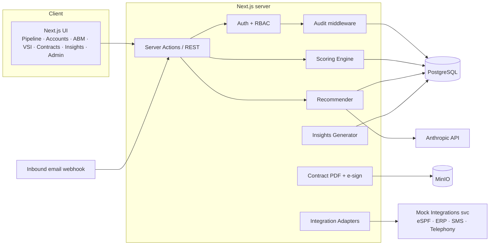

# System Architecture (CTO / Senior Architect)

## Stack (locked — see ADR-001)

- **App:** Next.js 15 (App Router) + TypeScript, server actions + REST route handlers
- **UI:** Tailwind + shadcn/ui + Recharts + TanStack Table
- **DB:** PostgreSQL 16 via Prisma
- **Auth:** Auth.js (credentials + optional Google), session-based, role claims
- **Jobs:** Simple in-process scheduler (node-cron) for nightly recompute; BullMQ + Redis only if time allows
- **Files:** MinIO (S3-compatible) for contract PDFs
- **PDF:** @react-pdf/renderer (contracts), pdf-lib (signature stamping)
- **LLM:** Anthropic API from server only; outputs cached in `AiArtifact`
- **Infra:** docker-compose (app, postgres, minio, mock-integrations); deployed to a single VPS or Railway/Render

## Diagram



## Module boundaries (folder = owner)

```
src/
  app/                 routes (pipeline, accounts, abm, vsi, engagement, contracts, cims, insights, admin, api)
  modules/
    pipeline/          leads, opportunities, stages        (Dev A)
    accounts/          account 360, contacts, subscriptions (Dev A)
    abm/               committees, account plans, playbooks (Dev C)
    engagement/        events, timeline                    (Dev C)
    intelligence/      scoring, grading, recommender, insights, llm (Dev B)
    dashboards/        vsi, forecast, charts               (Dev B)
    contracts/         templates, pdf, esign, renewals     (Dev C)
    cims/              rbac, audit, api keys, data-protection (Dev A)
    integrations/      adapters + mocks                    (Dev C)
  lib/                 db, auth, audit, errors, validation
  components/ui/       shadcn
prisma/                schema, migrations, seed
mock-integrations/     tiny Express app
```

Each module exposes: `actions.ts` (server actions), `queries.ts`, `service.ts` (pure logic, unit-tested), `types.ts`.

## Cross-cutting rules

- **Audit:** every write goes through `withAudit(actor, entity, before, after)`.
- **RBAC:** `requireRole(['ADMIN','MANAGER'])` at the action boundary; row-level: reps see own + team accounts.
- **Validation:** zod schemas shared between server action and API route.
- **Errors:** typed `AppError` → toast in UI, JSON in API.
- **IDs:** cuid. Money in integer ngwee (ZMW × 100).
- **Time:** store UTC, display Africa/Lusaka.

## Scoring engine design

Pure function `computeScore(input: ScoreInput): ScoreResult` in `intelligence/scoring.ts`, no DB access → trivially unit-tested against the spec's worked example. A thin `recomputeOpportunity(id)` loads inputs, calls it, writes `score`, `grade`, `weightedValue`, `explanation` JSON, and appends `ScoreHistory`.

## Deployment

- `docker compose up` for local & judge-laptop fallback.
- Production: Railway/Render (app + Postgres) + MinIO or Cloudflare R2. GitHub Actions: lint → typecheck → unit tests → build → deploy on `main`.
- Seed command idempotent: `pnpm db:seed --reset`.
