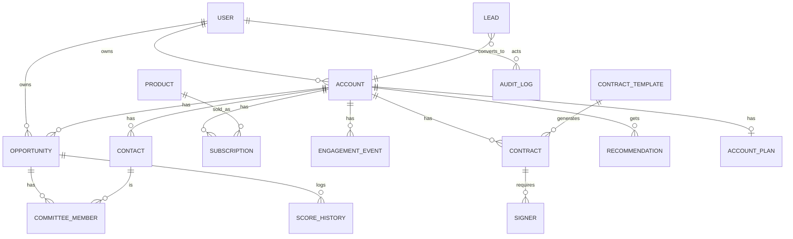

# Data Model

Full schema: `prisma/schema.prisma`. Entity relationship summary:

## Key design decisions

- **Lead is separate from Opportunity** (challenge: "lead vs pipeline separation"). Conversion creates Account (or links existing) + Opportunity and marks Lead CONVERTED.
- **Buying committee is per-opportunity**, not per-account - the same contact can be Champion on one deal and Blocker on another.
- **Subscriptions = "service usage"**: what the account already buys. Drives whitespace and recommender.
- **EngagementEvent is the single timeline**: emails, calls, tours, demos, notes all land here. Integrations write here too.
- **Score fields are denormalised on Opportunity** for fast Kanban; `ScoreHistory` gives trend.
- **Recommendation and Insight are materialised**, regenerated by jobs - the UI never computes them on request.
- **AiArtifact caches every LLM call** so demo works offline.
- **Money as integers** (ngwee). Format with `formatZMW()`.

## Seed sizes

8 users · 60 accounts · 180 contacts · 40 leads · 150 opportunities · 8 products · 110 subscriptions · 600 engagement events · 25 contracts · 3 templates · ~40 insights · ~120 recommendations.
