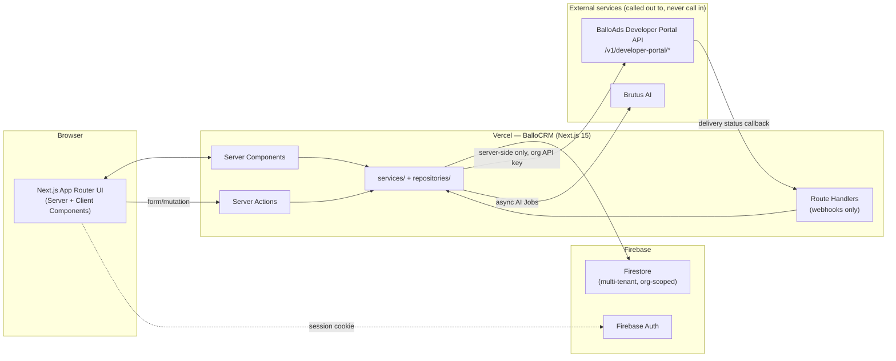

# Architecture

This document describes how BalloCRM is put together: the system-level picture, the internal
layering every feature must follow, how internal vs external API surfaces are split, how
authentication and multi-tenancy work, and how the three external dependencies (Firestore,
BalloAds, Brutus AI) are consumed. It is the map other docs assume you already have — for exact
schemas, rules, endpoints, and deploy steps, follow the links out to
[database-schema.md](./database-schema.md), [firestore-rules.md](./firestore-rules.md),
[api.md](./api.md), [integrations.md](./integrations.md), and [deployment.md](./deployment.md).

> Status note: this document describes both what is built and what is planned. Anything not
> marked "implemented" should be read as the target design, not current behavior — see
> [progress.md](./progress.md) for the live state and [roadmap.md](./roadmap.md) for sequencing.

## 1. System Architecture

BalloCRM is the hub. It owns its own data (Firestore) and its own identity (Firebase Auth), and it
reaches out to two external systems as a client — BalloAds for messaging/commercial data, and
Brutus AI for intelligence. Neither BalloAds nor Brutus ever calls into BalloCRM directly except
through a small, explicit webhook surface (delivery-status callbacks). BalloCRM never embeds,
forks, or reimplements BalloAds' own auth, sending, or automation engine — it consumes BalloAds as
a service via per-organization developer API credentials.



Key points:

- **BalloCRM is always the caller** toward BalloAds and Brutus AI. The one exception is BalloAds
  calling back into BalloCRM's own webhook Route Handler to report delivery status — even then,
  BalloCRM initiated the original send and is just receiving an async result, not being driven by
  BalloAds.
- **Firebase is BalloCRM's own infrastructure**, not shared with BalloAds. BalloAds has its own,
  separate authentication system that BalloCRM never touches.
- **Nothing external ever gets a Firestore reference or an Admin SDK credential.** All Firestore
  access is mediated by BalloCRM's own server-side code.

## 2. Component Architecture

Inside the Next.js app, every feature follows the same one-directional layering, from UI down to
the database. Each layer only talks to the layer directly below it — UI code never imports
Firestore directly, and repositories never contain business logic.

```
UI (Server Components / Client Components)
        |
        v
actions/            <-- thin Server Action entry points, one per user intent
        |
        v
services/           <-- business logic; composes one or more repositories
        |
        v
repositories/        <-- all direct firebase/firestore calls live here, nowhere else
        |
        v
Firestore
```

- **`features/<name>/`** is where a business capability's UI, hooks, Zod schemas, and
  feature-specific Server Actions live together (e.g. `features/accounts/`,
  `features/opportunities/`). A feature folder is self-contained; when a feature needs another
  feature's data it goes through `services/`, not by importing the other feature's internals
  directly.
- **`actions/`** at the repo root (and per-feature `actions.ts` files inside a feature folder) hold
  Server Actions — the only thing UI code calls to trigger a mutation or a server-side read tied
  to user interaction. Actions validate input with a Zod schema from `schemas/`, call a service,
  and return a typed result. They contain no Firestore calls and no business rules of their own.
- **`services/`** contains business logic — the rules about _what should happen_ (e.g. "creating
  an opportunity with stage `closed_won` should log an activity and trigger a BalloAds journey").
  Services compose one or more repositories and are the only place that talks to BalloAds/Brutus
  AI clients in `lib/`.
- **`repositories/`** contains every direct `firebase/firestore` read/write, scoped to one
  Firestore collection or a tight cluster of related collections. This is the only layer allowed
  to import the Firestore SDK. Keeping this boundary strict means swapping persistence details,
  writing focused tests, or auditing every raw query later is a one-folder search.

**Server Components vs Client Components — the decision rule.** Default to a Server Component.
Reach for a Client Component (`"use client"`) only when the code needs one of: local React state or
effects, a browser-only API, an event handler that can't be expressed as a form action, or a
third-party library that assumes a browser. Data fetching, layout, and anything that can render
from server-side data stays a Server Component; interactive leaves (a filter dropdown, an inline
edit cell, a chart with hover state) are pushed down into small Client Components as far from the
root as possible, so the majority of the tree stays server-rendered.

## 3. API Architecture

BalloCRM exposes two different kinds of internal HTTP surface, and they are not interchangeable:

| Surface                                    | Used for                                                                                                           | Called by                                             |
| ------------------------------------------ | ------------------------------------------------------------------------------------------------------------------ | ----------------------------------------------------- |
| **Server Actions**                         | Everything UI-initiated: form submits, inline edits, list mutations, anything a signed-in CRM user does in the app | The app's own Server/Client Components, directly      |
| **Route Handlers** (`app/api/**/route.ts`) | Webhooks and callbacks — anything a _third party_ calls into, e.g. a BalloAds delivery-status callback             | An external system (BalloAds), never the CRM's own UI |

The rule of thumb: if the caller is "a browser tab with a signed-in BalloCRM user in it," use a
Server Action. If the caller is "some other system on the internet telling BalloCRM something
happened," use a Route Handler. Server Actions get Next.js's built-in CSRF protection and a typed,
co-located call site next to the component that invokes them, which is why they are preferred for
anything UI-initiated instead of hand-rolling a `fetch` to an internal API route. Route Handlers
exist specifically because webhooks need a stable, unauthenticated-by-cookie URL that a remote
service can `POST` to directly.

The concrete, current list of Route Handlers and the Server Actions catalog per feature live in
[api.md](./api.md) — this document only defines which bucket a given piece of functionality
belongs in.

## 4. Authentication

BalloCRM uses **Firebase Authentication** for its own users (CRM staff — sales reps, managers,
admins), completely separate from BalloAds' own auth system.

Planned session flow (see [progress.md](./progress.md) for current build status — as of this
writing, the `/login` route and the sign-in flow itself do not exist yet):

1. User signs in via Firebase Auth on the client (`lib/firebase/client.ts`).
2. The client exchanges the Firebase ID token for a server-issued session cookie (`__session`),
   which gets set as an HTTP-only cookie.
3. Subsequent requests carry that cookie; Server Components/Actions that need the authenticated
   user verify it server-side using the Admin SDK (`lib/firebase/admin.ts`).

**What `middleware.ts` does today, precisely:** it checks whether a `__session` cookie is _present_
on non-public paths and redirects to `/login` if it is absent. **It does not verify the token.**
This is deliberate, not an oversight — Next.js Middleware runs on the Edge runtime, which cannot
run the Firebase Admin SDK, so a cryptographic/session check can't happen there. Treat the
middleware purely as a cheap, coarse gate that keeps signed-out browsing away from protected
routes; it is not a security boundary on its own. **Real verification of the session — confirming
the cookie is a valid, unexpired Firebase session and resolving it to a `uid` — must happen inside
the Server Component or Server Action behind the gate**, using the Admin SDK. Any code that treats
the middleware's redirect as proof of a verified identity is a bug.

**Multi-tenant org model.** Every BalloCRM user is a member of exactly one organization:

- `users/{uid}` — a top-level document holding at minimum `orgId` and `role`.
- `organizations/{orgId}/...` — every piece of CRM data (accounts, contacts, opportunities, etc.)
  lives in subcollections scoped under the user's `orgId`.
- Access control is role-gated: `owner`, `admin`, `manager`, `rep`, `viewer`, enforced both in
  Firestore Security Rules and, for anything more nuanced than "can read/write this collection,"
  in the `services/` layer.

This means every repository/service function that touches `organizations/{orgId}/...` must be
called with an `orgId` derived from the verified session, never from client-supplied input, so
that one organization's data can never leak into another's queries. The full collection list,
document shapes, and indexing strategy are in [database-schema.md](./database-schema.md); the
enforced rules themselves are in [firestore-rules.md](./firestore-rules.md).

## 5. Firestore

At a glance, the data model has two top-level shapes: a small set of global collections for
identity, and a large set of collections nested under each organization. This section only lists
collection names for orientation — full document shapes, field types, and indexing live in
[database-schema.md](./database-schema.md), and the enforced access rules live in
[firestore-rules.md](./firestore-rules.md).

- **Global:** `users/{uid}`
- **Per-organization**, under `organizations/{orgId}/`: `accounts`, `contacts`, `opportunities`,
  `tasks`, `contracts`, `campaigns`, `activities`, `notifications`, `auditLogs`, `aiJobs`,
  `templates`, `analyticsCache`, `settings`, `integrations`

Two modeling decisions worth calling out here because they affect how every layer above Firestore
is written (full rationale in [decisions.md](./decisions.md)):

- There is **no separate `timeline` collection**. "Customer Journey" / timeline views for an
  Account or Contact are a query over `activities` filtered by `relatedTo.type` + `relatedTo.id`
  (backed by a composite index), so the same event is never written twice for "audit log" and
  "timeline" purposes.
- `organizations/{orgId}/integrations/{provider}` (e.g. `balloAds`) holds encrypted third-party
  credentials and is **not readable or writable by any client SDK** — Security Rules deny all
  direct access; every read/write goes through the Admin SDK from server-side code only.

## 6. BalloAds Integration

BalloCRM never talks to BalloAds from the browser. All calls to BalloAds' Developer Portal API
(`/v1/developer-portal/*`) happen from server-side code — a `services/` function calling a BalloAds
client in `lib/` — using a per-organization developer API key read (decrypted) from
`organizations/{orgId}/integrations/balloAds` via the Admin SDK. This is not a stylistic
preference: the developer API key is a long-lived credential scoped to an entire organization's
BalloAds account, and it must never reach a browser where it could leak via devtools, an extension,
or a logging mistake. BalloAds is treated strictly as a service BalloCRM consumes for messaging
delivery, opt-out/delivery status, and enrichment data such as an externally computed account
health score — BalloCRM does not reimplement any BalloAds sending or automation logic itself. Full
endpoint list, payload shapes, and what is confirmed vs. still "to be verified against the live
API" are documented in [integrations.md](./integrations.md).

## 7. Brutus AI Integration

AI work (opportunity qualification scoring, next-best-action, account/contact summarization,
cross-sell signal detection, natural-language analytics) is modeled as an asynchronous **AI Job**,
not a synchronous request inline in a page load. A Server Action creates an `aiJobs` document in
`queued` state, a backend process (or a callback) moves it through `running` to
`completed`/`failed`, and the UI polls or subscribes to that document to render a result when it's
ready. This keeps page renders fast and keeps Brutus AI latency/failures from blocking the request
path. The one exception is a chat-style assistant UI, which may stream directly to the client
where the UX specifically calls for it. Job states, payload shapes, and prompts/response contracts
are documented in [integrations.md](./integrations.md).

## 8. Deployment Architecture

BalloCRM deploys as a standard Next.js app on **Vercel**, backed by **Firebase** (Auth + Firestore)
as its only stateful backend — there is no separate application database or server to operate.

```
local dev  --push-->  preview deployment (per PR)  --merge to main-->  production
     |                          |                                          |
     +--- Firebase project(s) shared or split per environment, per config in
          environment.md -------------------------------------------------+
```

Three environments are relevant: local development, Vercel preview deployments (one per pull
request), and production. Each environment is driven by its own environment variables, validated
by the Zod schemas in `config/env.ts` (`getClientEnv()` / `getServerEnv()`), so a missing or
malformed variable fails fast at startup rather than surfacing as a runtime error deep in a
request. Concrete environment variable lists, Firebase project setup, and the Vercel project
configuration are documented in [deployment.md](./deployment.md) and [environment.md](./environment.md).
